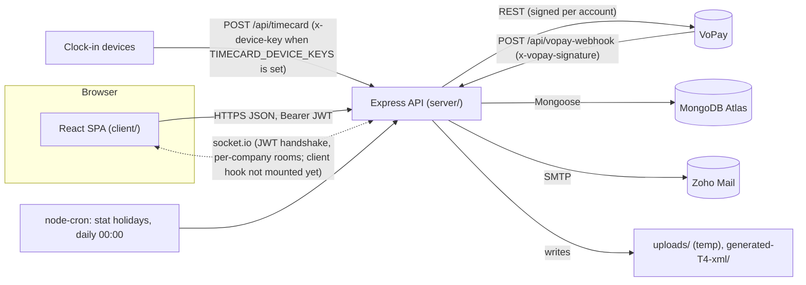
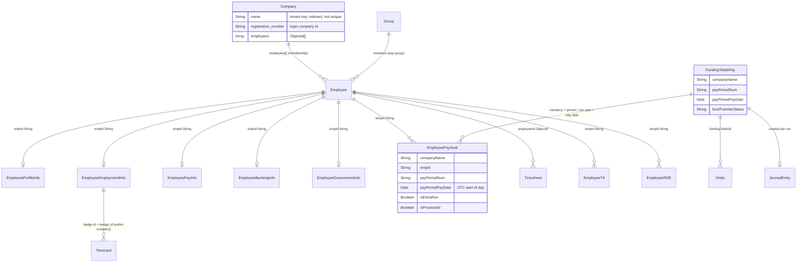

# BusinessN ERP: technical reference

This covers the architecture, the REST API and the MongoDB data model. Everything here comes from the code on the `docs-tests-improvements` branch: `server/app.js`, `server/index.js`, `server/middleware/*`, `server/routes/*`, the controllers and `server/models/*`. Fix and issue IDs (AUD-xxx, NEW-xx, PAYYEAR-01, ...) match code comments and are explained in [CHANGES.md](CHANGES.md). Setup, environment variables and commands are in the [README](../README.md).

## 1. Architecture

### 1.1 System context



### 1.2 Boot sequence (`server/index.js`)

1. Load `.env`, or `.env.local` when `NODE_ENV=development`. `config/app.config.js` reads required variables through `requireEnv`, which throws at start-up when one is missing.
2. Create the HTTP server and the socket.io instance (CORS from `CONFIG.corsOptions`). `helpers/socketAuth.js` authenticates every handshake. Requests under `/socket.io/` go to socket.io only, never to Express (SOCK-01).
3. `buildApp(io)` from `app.js` builds the Express app. Tests import `buildApp` directly, with no database and no port.
4. Register a process-level `unhandledRejection` logger (NEW-03) and start the stat-holiday cron job.
5. `mongoose.connect(...)`. A failed connection is logged, not thrown. The server keeps serving and DB-backed requests fail.

### 1.3 Middleware order (`server/app.js`)

| # | Middleware | Applies to |
|---|---|---|
| 1 | `express.static("/assets")`, EJS views and layouts | all |
| 2 | `express.json` / `urlencoded` (50 MB limit), `cookieParser` | all |
| 3 | `cors(CONFIG.corsOptions)`, `helmet` (CSP with nonce, COEP/CORP/COOP, `Referrer-Policy: no-referrer`) | all |
| 4 | Request log, then `globalLimiter`: 500/min with a valid access token, 200/min otherwise | all except `/api/login`, `/api/auth*`, `/api/refresh-token` |
| 5 | `authLimiter`: 20 per 15 min, keyed by IP + lower-cased e-mail | `/api/login`, `/api/forgot-password`, `/api/reset-password/*`, `/api/refresh-token` |
| 6 | Routers mounted **before** global auth: `appRoutes` (`/api`), `/api/timecard` (own 200/min limiter), `/api/ticket`, `/api/resource`, `/api/vopay-webhook` | each adds its own auth (section 2.3) |
| 7 | `authenticateToken`: verifies the JWT signature and `exp`, sets `req.user = {id, fullName}` | everything below |
| 8 | `authorizeCompanyAccess`: `companyName`/`company` in body and query must be one of the caller's companies; a non-string value is `400 INVALID_COMPANY` | everything below |
| 9 | 42 routers, each wrapped in `applyCompanyParamGuards` (checks `:companyName` and `:company` params); gated routes add `requireRole(...)` | |
| 10 | JSON `404 {"message":"Not found"}` for unknown `/api/*`, then `errorHandler` | |

### 1.4 Server layers

```
routes/        47 files: URL -> controller function
controllers/   56 files: parsing, validation, response; most business logic lives here
services/      user, payroll, tax, token, password, e-mail, file, encryption, timecard, project completion
helpers/       payrollHelper (pay maths), percent, socketAuth, escapeHtml, requestFields, requireEnv, apiFetch (VoPay)
utils/         db.util (runInTransaction, index-error logging), payYear.util, date.util, time.util
middleware/    auth.js (JWT, errorHandler), authorize.js (tenancy, requireSelf), rbac.js (roles), deviceAuth.js
models/        88 files; about 65 in active use (section 4)
jobs/          statHoliday.js: daily cron adding stat-holiday timesheets per company
views/         EJS pages for password reset
scripts/       check-duplicates.js, resolve-duplicates.js
```

Controllers often call each other directly (for example `employmentInfoController` imports from `userController`, `payInfoController`, `timecardController` and `permissionController`). There is no separate domain layer, so changes to shared controller functions have a wide blast radius. That is one reason the tests mock at the model level.

### 1.5 Authentication

* **Login:** `POST /api/login {email, password, companyId}`. `companyId` is the company's **registration number**, and the user must be in that company's `employees` array.
* **Tokens:** HS256 JWTs from `jwt-simple`, payload `{id, fullName, exp}`, separate secrets. Access token 2 h; refresh token 5 h, not rotated on refresh. Password-reset token 15 min, signed with `ACCESS_TOKEN_SECRET` plus the user's current password hash, so any password change invalidates outstanding links.
* **Client storage:** access token in `sessionStorage`, refresh token in `localStorage`. The Axios interceptor (`client/src/api/index.js`) refreshes once on a 403 whose `code` is `TOKEN_INVALID` or `TOKEN_MISSING`, or that has no code. It never refreshes on `COMPANY_ACCESS_DENIED`, `ROLE_FORBIDDEN` or `FORBIDDEN`.
* **No revocation:** logout closes the `UserActivity` record but tokens stay valid until they expire (AUD-029).

### 1.6 Tenancy (`middleware/authorize.js`)

A tenant is a company **name**. A user may act on company X only if `Company{name: X}.employees` contains `req.user.id`, the same rule login uses. Memberships are cached per user for 60 s (bounded to 5,000 entries).

| Guard | Checks | Where |
|---|---|---|
| `authorizeCompanyAccess` | body `companyName`/`company`, query `companyName`; non-string → `400 INVALID_COMPANY`; `""`, `"null"`, `"undefined"` ignored | app-wide after auth; inside the ticket, resource and time-card routers |
| `applyCompanyParamGuards` | `:companyName` and `:company` route params | every protected router |
| `requireCompanyNameParam("name")` | `:name` used as a company | `GET /api/company/:name`, four schedule routes (SEC-01) |
| `requireCompanyIdMembership("id")` | `:id` is a company the caller belongs to | `PUT /api/company/:id` |
| `authorizeMultipartCompany` | company fields after multer has parsed the form; deletes the upload before answering 403/400 | ticket create, resource upload |
| `authorizeEntryCompanies` | each entry of an array body | `POST /api/timecard/manual` |
| `requireDocumentInCallerCompany(Model)` | the `:id` record's company: 400 bad id, 404 missing, 403 other company | `PUT /api/ticket/:id`, `PUT`/`DELETE /api/resource/:id` |
| `requireSelf("id")` | `:id` equals the caller | `GET /api/logout/:id`, `PUT /api/change-password/:id` |
| `companyScopeFilter` | list endpoints without a company in the URL return only the caller's companies (`?companyName=` narrows; a foreign one gives an empty list) | users, user activity, companies, resources, contacts, events, log-tasks, meetings, notes, projects, questionnaires, schedule, tasks, ticket `/:id`, downloads |

Not scoped: Notification, Opportunity and the global SetUp rule have no company field, and `GET /api/leads/grouped-opportunities` and `GET /api/conversations/group` aggregate across companies. Object-level checks are still missing on most other `:id`-only routes (AUD-033).

### 1.7 Role-based access control (`middleware/rbac.js`, AUD-028)

The caller's role in a company is `EmployeeEmploymentInfo.employmentRole` for `(companyName, empId = caller)`, cached 60 s. A Shadow Admin of BusinessN Corporate counts as Shadow Admin in every company they belong to. The matrix mirrors the client's own rules:

| Group | Allowed roles | Gates |
|---|---|---|
| `PAYROLL_SUBMIT` (AuthAdmin+) | Authorizing Admin, Shadow Admin, Super Admin | `PUT /api/payroll/report/submit/:id`; every VoPay `POST` |
| `ADMIN_LEVEL` (Admin+) | Administrator and above | permission writes; Admin-console setup writes (roles, departments, cost centres, modules, group create, pay cycle, employment types) |
| `MANAGER_LEVEL` (Manager+) | Manager and above | `POST /api/payroll/process`, `PUT /api/company/:id`, setup writes used by Manager pages (locations, crews, position roles, `PUT groups/:id`) |
| `ROLE_ACCESS[callerRole]` | the role being granted must be one the caller may grant (Enroller < Employee < Manager < Administrator < Authorizing Admin < Shadow Admin < Super Admin) | `POST`/`PUT /api/payroll/employmentInfo` when `employmentRole` changes; `PUT /api/user/:userId` |

* The company comes from params, body or query, or, for `:id` routes, from the target record (plus any company in the request). The role must be allowed in **every** company involved.
* No company → `400 COMPANY_REQUIRED`. Role not allowed, including an empty or unknown role → `403 ROLE_FORBIDDEN`. Record in a company the caller doesn't belong to → `403 COMPANY_ACCESS_DENIED`, in report mode too (RBAC-REPORT-01). Unknown `:id` with no company → `404 "<Model> not found"`.
* `RBAC_MODE=report` logs `RBAC report-only: would deny` and lets the request through. Read routes are not role-gated (API #24).

### 1.8 Device authentication (`middleware/deviceAuth.js`, AUD-013)

`POST /api/timecard` is mounted before `authenticateToken` because devices post without a user session.

| `TIMECARD_DEVICE_KEYS` | Request | Result |
|---|---|---|
| unset or empty | anything | accepted; one warning logged at start-up |
| set | `x-device-key` matches a key (SHA-256 digests, constant-time compare) | accepted |
| set | wrong `x-device-key` | `401 DEVICE_KEY_INVALID` |
| set | no key but an `Authorization` header | handled as a user token (the web UI's refresh button) |
| set | neither | `401 DEVICE_KEY_MISSING` |

Keys are read on every request, so rotating them needs only an environment change. Punches carry a badge id, not a company: a badge that matches active employees in two or more companies is not booked (raw punch kept, `LEFT-03` warning logged).

### 1.9 Socket.io (`helpers/socketAuth.js`)

* The client connects with `io(url, {auth: {token: <accessToken>, companyName?}})`.
* Handshake errors: `TOKEN_MISSING`, `TOKEN_INVALID`, `COMPANY_ACCESS_DENIED` (named company not a membership), `SOCKET_AUTH_FAILED`.
* The socket joins `company:<name>` rooms for the named company, or for all of the user's companies.
* VoPay webhook payloads are emitted as `vopay-event` only to the room of the company they map to. Today only Cornerstone account ids map; other payloads are logged and dropped. The client hook `hooks/useVoPayEvents.js` is ready but not mounted (`features/configuration/vopay/index.jsx`).

### 1.10 Pay run and payroll submit

```mermaid
sequenceDiagram
  participant UI as process-payroll UI
  participant API as POST /api/payroll/process (Manager+)
  participant PS as payStubController
  participant H as payrollHelper / taxService
  participant DB as MongoDB
  UI->>API: {companyName, currentPayPeriod}
  API->>PS: validate (400), in-process lock company|period|run type|frequency (409 PAYRUN_IN_PROGRESS)
  PS->>DB: active employees, approved timesheet hours, pay info, benefits, tax credits, extra allocations
  PS->>H: hours -> gross -> CPP / EI / federal / BC tax -> contributions -> net
  PS->>DB: one transaction: upsert each EmployeePayStub + FundingTotalsPay on natural keys
  PS-->>API: 200 {"message":"Paystub created successfully"}
  PS--)DB: journal entry after commit; T4 generation in background (failures logged)
```

* **Transaction:** all stub and funding-total writes run in one MongoDB transaction (`utils/db.util.js:runInTransaction`). With `PAYRUN_TRANSACTIONS=off`, a standalone `mongod` or no connection, writes run without one and a warning is logged once.
* **Idempotency:** each stub is an atomic upsert on `(companyName, empId, payPeriodNum, isExtraRun, scheduleFrequency, reportType: null, isProcessed: true)` within the **pay-date year**; funding totals upsert on `(companyName, payPeriodNum, isExtraRun, payPeriodPayDate, scheduleFrequency)`. Unique indexes back both (section 4.3), so a re-run updates instead of duplicating, across processes too. A regular run no longer overwrites the same period's extra-run stub. The 409 lock is per process only.
* **Submit** (`PUT /api/payroll/report/submit/:id`, AuthAdmin+): saves `yearSchedules` on the pay group, reads the run's funding totals (matched on the whole UTC pay day) and the year-scoped stubs, then atomically claims the run on `FundingTotalsPay.fundTransferStatus` (`in_progress` → `sent`/`failed`/`skipped`, plus `fundTransferAt`) before calling VoPay. A repeat or concurrent submit returns `skipped` with `ALREADY_SENT` or `IN_PROGRESS` and transfers nothing; a failed transfer can be retried (SUBMIT-01). If the server dies mid-transfer the run stays `in_progress`: check VoPay before resetting it by hand.
* **Cornerstone** transfers are signed with Cornerstone's own key (NEW-04), so they now succeed and move real money. Other companies get `skipped: COMPANY_NOT_ENABLED`.

### 1.11 Client

```
src/index.js -> App.js -> routes.js (createBrowserRouter; authenticated modules lazy-loaded, public pages too)
  layouts/       PageLayout (detects phone viewport), RootLayout (header, sidebar, mobile drawer)
  erp-modules/   payroll, sales, project-management, scheduling, accounting, budgeting, operations, hr
  features/      login, sign-up, verify-user, user, configuration (VoPay), setup, support
  components/    shared UI: chart registry (components/ui/charts), print modal, header, sidebar, ComingSoon
  hooks/         45 use*.js data hooks -> services/ (33 *Service.js) -> api/index.js (single Axios instance)
  context/       AuthContext, DataContext
  constant.js    ROLES, ROLE_ACCESS, route paths, company constants
```

* **Data flow:** page → hook (e.g. `useTimesheet`) → service (`TimesheetService.getTimesheets`) → Axios `API` instance → Express route.
* **State:** mostly component state, plus `localStorage` (`user`, selected company, module) and two small contexts; no global store.
* **Build:** CRA 5. `prebuild` writes `version.json`, which `versionCheck.js` uses to prompt a reload after a deploy. chart.js parts are registered explicitly in `components/ui/charts/index.js`.

### 1.12 Deployment and scaling

| Piece | Host | Notes |
|---|---|---|
| Client | Netlify | `client/netlify.toml`: base `client`, `npm run build`, SPA fallback |
| Server | Render/Heroku style | `server/Procfile` (`node index.js`); set `TRUST_PROXY=1` behind the platform proxy |
| Database | MongoDB Atlas | replica set, so pay-run transactions are used; indexes built by `autoIndex` on every boot |

Run **one** server instance. The rate-limit stores, the membership and role caches and the pay-run lock are in memory; more than one instance needs a shared store such as Redis (AUD-034). The unique indexes still prevent duplicate pay stubs across instances. Request logging prints every request to stdout.

## 2. API reference

336 active routes in 47 route files, all under `/api`. Counts by auth class: public 8, VoPay signature 1, device 1, token + self 2, token 172, token + tenant guard 116, token + tenant guard + role 31 (AuthAdmin+ 9, Admin+ 15, Manager+ 7), role-assignment check 2, object-level check 3.

### 2.1 Conventions

* **Auth:** `Authorization: Bearer <accessToken>` on every route except the public ones listed in 2.3.
* **Bodies:** JSON (50 MB limit). Uploads are multipart with field `file` (10 MB limit, sanitised file names); stored bytes go to MongoDB and temp files are deleted.
* **Status codes:** 200 read and some updates; 201 create, and **many updates also return 201**; 400 validation; 401 missing token or bad credentials; 403 token, tenant, role or self denial; 404 not found; 409 duplicate create or pay run in progress; 413 upload too large; 429 rate limited; 500 error; 501 not implemented.
* **Error bodies:** `{"message": "..."}`; middleware adds `"code"`. `errorHandler` hides 5xx details, but most controllers still return `{"message":"Internal Server Error","error":{...}}` with the raw error (API #17). Some bodies are bare JSON strings, and the VoPay webhook answers `text/plain`.

| Code | Status | Body / meaning |
|---|---|---|
| `TOKEN_MISSING` | 401 | `{"message":"Access token is required","code":"TOKEN_MISSING"}` |
| `TOKEN_INVALID` | 403 | `{"message":"Invalid or expired token","code":"TOKEN_INVALID"}`: bad signature, expired, no `id`; the client refreshes |
| `COMPANY_ACCESS_DENIED` | 403 | `{"message":"You do not have access to this company","code":"COMPANY_ACCESS_DENIED"}` |
| `INVALID_COMPANY` | 400 | `{"message":"Company name must be text","code":"INVALID_COMPANY"}`: e.g. `{"$ne":"x"}` or `?companyName[$ne]=x` |
| `ROLE_FORBIDDEN` | 403 | `{"message":"Your role does not allow this action","code":"ROLE_FORBIDDEN"}` |
| `COMPANY_REQUIRED` | 400 | `{"message":"Company is required for this action","code":"COMPANY_REQUIRED"}`: role-gated route without a company |
| `FORBIDDEN` | 403 | `{"message":"You can only perform this action on your own account","code":"FORBIDDEN"}` |
| `DEVICE_KEY_MISSING` / `DEVICE_KEY_INVALID` | 401 | time-card device key |
| `RESET_TOKEN_INVALID` | 400 | bad or expired reset link |
| `RATE_LIMITED` | 429 | `{"message":"Too many attempts. Please wait 15 minutes before retrying.","code":"RATE_LIMITED"}` (auth limiter) |
| `PAYRUN_IN_PROGRESS` | 409 | same pay run already running in this process |
| `NOT_IMPLEMENTED` | 501 | pay-group stubs, T4 listing, three VoPay handlers |

**Rate limits:** global 500/min with a valid token, 200/min without (`{"message":"Too many requests. Please wait before retrying."}`); auth limiter 20 per 15 min per IP + e-mail; time-card limiter 200/min (plain-text 429). `/api/signup` has no auth limiter. `X-Forwarded-For` is honoured only when `TRUST_PROXY` is set. Responses carry `RateLimit-*` headers.

### 2.2 Key endpoints

#### `POST /api/login` (public, auth limiter)

```json
{ "email": "jane@example.com", "password": "••••••••", "companyId": "<Company.registration_number>" }
```

Errors: 400 `"Email, password, and company ID are required"`; 400 `"... must be text"` for non-strings; 401 `"Invalid credentials. Please reset your password!"` for unknown e-mail, wrong company, no hash or wrong password (same message every time). Login closes open `UserActivity` sessions and opens a new one. Response 200 (`role` and `employmentType` both come from `employmentRole`):

```json
{
  "message": "Logged in successfully",
  "user": { "_id": "...", "firstName": "...", "lastName": "...", "fullName": "...", "email": "...",
            "role": "...", "department": "...", "employmentType": "...", "employeeId": "...",
            "payrollStatus": "...", "phoneNumber": "...", "primaryAddress": { }, "manager": "..." },
  "existingCompanyUser": { "_id": "...", "name": "...", "registration_number": "...", "address": { } },
  "accessToken": "<jwt, 2h>",
  "refreshToken": "<jwt, 5h>"
}
```

#### `POST /api/refresh-token` (public, auth limiter)

Request `{ "refreshToken": "<jwt>" }` → 200 `{ "accessToken": "<new jwt, 2h>" }` (no new refresh token). Errors: 401 `"Refresh token is required"`; 403 `"Invalid refresh token payload"` (no `id`); 403 `"Invalid or expired refresh token"`. An access token sent as a refresh token, or the reverse, is rejected (different secrets).

#### `POST /api/forgot-password` (public, auth limiter)

Request `{ "email": "jane@example.com" }`. Missing or non-string e-mail → 400 `"Email is required"`. Known **and** unknown e-mail both return the same 200 (no enumeration):

```json
{ "message": "If an account exists for this e-mail, a reset link has been sent. Please check your inbox." }
```

The e-mailed link is `${BASE_URL_LIVE}/api/reset-password/<userId>/<token>`, valid for 15 minutes. Mail failure → 500.

#### `GET` / `POST /api/reset-password/:id/:token` (public, auth limiter)

`GET` renders the EJS reset page: 400 with status `Expired` for a bad link, 200 with the form otherwise. `POST { "password": "new-password" }`: the password must be a string of 8–128 characters.

| Condition | Status | Body |
|---|---|---|
| bad `:id`, unknown user, bad or expired token | 400 | `{"message":"This reset link is invalid or has expired","code":"RESET_TOKEN_INVALID"}` |
| password rule failed | 400 | JSON `{"message":"Password must be at least 8 characters"}` for `Accept: application/json`, otherwise the page re-rendered |
| success | 200 | **HTML** page with status `Verified`, also for JSON clients |

On success the bcrypt hash is stored on `Employee.password` and the legacy `EmployeeProfileInfo.password` is unset. The link stops working once the password changes.

#### `PUT /api/change-password/:id` (token + self)

```json
{ "currentPassword": "old", "newPassword": "new-password", "confirmPassword": "new-password" }
```

Checked in order: 403 `FORBIDDEN` (`:id` isn't the caller); 400 `"Invalid user id"`; 400 new-password rule; 400 `"Passwords do not match"` (`confirmPassword` is optional); 400 `"Current password is required"`; 404 `"User not found"`; 401 `"Current password is incorrect"`; 400 `"New password must differ from the current password"`. Success: 200 `{ "message": "Password changed successfully" }`.

#### `POST /api/payroll/process` (token + tenant guard + Manager+)

```json
{
  "companyName": "Acme",
  "deptName": "optional",
  "selectedPayGroupOption": "optional pay group",
  "currentPayPeriod": {
    "payPeriodStartDate": "2026-10-01", "payPeriodEndDate": "2026-10-14",
    "payPeriodPayDate": "2026-10-17", "payPeriodProcessingDate": "2026-10-15",
    "payPeriod": 20, "frequency": "bi-weekly", "isExtraRun": false, "selectedEmp": []
  }
}
```

| Condition | Status | Body |
|---|---|---|
| `companyName` not a non-empty string | 400 | `{"message":"companyName is required"}` |
| `currentPayPeriod` missing | 400 | `{"message":"currentPayPeriod is required"}` |
| start or end date missing | 400 | `{"message":"payPeriodStartDate and payPeriodEndDate are required"}` |
| extra run without a `selectedEmp` array | 400 | `{"message":"selectedEmp must be an array for an extra pay run"}` |
| same run already running in this process | 409 | `{"message":"A pay run for this company and pay period is already being processed","code":"PAYRUN_IN_PROGRESS"}` |
| not a member / role below Manager | 403 | `COMPANY_ACCESS_DENIED` / `ROLE_FORBIDDEN` |
| success | 200 | `{ "message": "Paystub created successfully" }` |

`frequency` spellings are normalised (`"bi-weekly"` → `Biweekly`, `"semi-monthly"` → `Semimonthly`). A regular run covers payroll-active employees (filtered by department and pay group) with approved timesheet hours; an extra run covers `selectedEmp`. Behaviour: section 1.10.

#### `PUT /api/payroll/report/submit/:id` (token + tenant guard + AuthAdmin+; moves money)

`:id` is a pay group (`Group`); the role is checked in the group's company and in `body.companyName`.

```json
{
  "companyName": "Acme",
  "yearSchedules": [ ],
  "currentPayPeriod": { "payPeriod": 20, "payPeriodPayDate": "2026-10-17", "payPeriodStartDate": "...",
                        "payPeriodEndDate": "...", "payPeriodProcessingDate": "...",
                        "isExtraRun": false, "frequency": "bi-weekly", "selectedEmp": [] }
}
```

Response 200, also when the transfer failed (the client shows a warning toast):

```json
{
  "employeePayStubs": [ { "_id": "...", "empId": "...", "currentNetPay": 1234.56 } ],
  "fundTotalsReport": { "totalFundingWithDrawals": 0, "totalEmpPaymentRemitCost": 0, "totalGovtContr": 0, "totalServiceCharges": 0 },
  "fundTransfer": { "status": "sent" }
}
```

| `fundTransfer` | Meaning |
|---|---|
| `{"status":"sent"}` | VoPay accepted the transfer |
| `{"status":"failed","error":"<message, URLs redacted>"}` | VoPay call failed (logged); the run can be submitted again |
| `{"status":"skipped","reason":"ALREADY_SENT"}` / `"IN_PROGRESS"` | run already paid or being paid; nothing transferred |
| `{"status":"skipped","reason":"NO_FUND_TOTALS"}` / `"NO_AMOUNT"` / `"COMPANY_NOT_ENABLED"` | no funding totals for the run / `totalEmpPaymentRemitCost` is 0 / company isn't Cornerstone |

Errors: 400 `COMPANY_REQUIRED`, 403 `ROLE_FORBIDDEN` or `COMPANY_ACCESS_DENIED`, 404 `"Group not found"`, 500 with the raw error.

#### `POST /api/timecard` (device)

A JSON **array** of punches:

```json
[ { "user_id": "7746", "timestamp": "2024-10-08 17:44:56", "status": "4", "punch": "0", "isNotDevice": false } ]
```

Each timestamp is converted to UTC; entries without `user_id` or dated on or before 2024-10-20 are skipped; duplicates by `{user_id, timestamp, punch}` are ignored. New punches are stored in `TimecardRaw` (awaited) and then mapped to `Timecard` by badge (section 1.8).

| Condition | Status | Body |
|---|---|---|
| success | 201 | `"Timecard entries added successfully"` (JSON string) |
| not an array, or a non-object entry | 400 | `{"message":"Expected an array of punch entries"}` |
| key required and missing / wrong | 401 | `DEVICE_KEY_MISSING` / `DEVICE_KEY_INVALID` |

`POST /api/timecard/manual` (token; every entry's company checked) takes `[{ "isNotDevice": true, "empId": "<id>", "companyName": "Acme", "punch": "0" }]` and answers once: 400 for bad input, 201 `"Timecard entries added manually"`, or 500 with per-entry `results`. Its punch-writing calls are commented out, so it currently stores nothing (API #22).

#### `POST /api/vopay-webhook` (VoPay signature)

Header `x-vopay-signature: <hex>`, compared in constant time with `sha1(SHARED_KEY + SHARED_SECRET + <UTC date YYYY-MM-DD>)` of the default account. The body is any JSON and is not validated.

| Condition | Status | Body (`text/plain`) |
|---|---|---|
| header missing or not equal | 401 | `Invalid signature` |
| accepted | 200 | `OK`; the payload is logged and emitted as `vopay-event` to the matching company room only |

The signature is constant for a whole UTC day and not bound to the payload (API #16, open).

### 2.3 Routers mounted before global auth

| Mount (route file) | Covers | Auth / role | Notable endpoints |
|---|---|---|---|
| `/api` (`appRoutes`) | sign-up, login, refresh, logout, password flows | public; logout and change-password token + self | `POST signup` (joins any company by name, AUD-030; response has no password hash or OTP), `POST login`, `POST refresh-token`, `GET logout/:id`, `POST forgot-password`, `GET`/`POST reset-password/:id/:token`, `PUT change-password/:id` |
| `/api/timecard` (`timecardRoutes`) | device punches, time cards, TAD profiles | `POST /` device; all others token + tenant guard | `GET /:companyName/:filter` (paginated punches), `GET tad-users`, `GET tad-filtered-users` (NW members only), `POST /manual` |
| `/api/ticket` (`ticketRoutes`) | support tickets, public contact/lead forms | `POST support`, `POST leads` public; rest token + tenant guard | `POST /` (multipart), `PUT /:id` (object-level), `GET count/:id/:companyName`, `GET open\|closed/:id/:companyName`, `GET download/:filename` |
| `/api/resource` (`resourceRoutes`) | training material and company files | token + tenant guard | `GET /:companyName`, `GET type/:fileType/:companyName`, `POST upload` (multipart), `PUT`/`DELETE /:id` (object-level), `GET download/:filename` |
| `/api/vopay-webhook` | VoPay callbacks | signature header | `POST /` |

### 2.4 Routers mounted after global auth

All need a token. Body/query companies are tenant-checked and `:companyName`/`:company` params guarded. "Token" in the auth column means no path-param guard and no object-level check on `:id`.

| Mount | Covers | Auth / role | Notable endpoints |
|---|---|---|---|
| `/api/affiliate` | affiliate profiles and sales | token / tenant guard | `GET /:companyName`, `POST /`, `POST sale` (409 duplicate) |
| `/api/accounting` | ledger accounts, general journal | token / tenant guard | `GET /:companyName`, `GET ledgers/:companyName`, `POST general-journal` |
| `/api/budgeting` | budget accounts | token / tenant guard | `GET /:companyName/:department`, `POST /` (also creates a ledger) |
| `/api/activities` | CRM contact activities | token / tenant guard | `GET user/:createdBy/:companyName/:filter`, `POST /` |
| `/api/alert` | pay-run alerts and violations | token / tenant guard | `GET detail/:companyName/:payPeriodNum/:selectedPayGroup`, `POST /` (recompute) |
| `/api/assessment` | assessments and types | token / tenant guard | `GET type/:companyName`, `POST /`, `DELETE /:id` (deletes a type) |
| `/api/company` | companies | token; `PUT /:id` Manager+ in that company | `GET /` (caller's companies), `POST /` (409 duplicate), `GET /:name` |
| `/api/contacts` | CRM contacts | token / tenant guard | `GET /:companyName`, `GET onboard/:companyName`, `POST followup`, `PUT /:id` |
| `/api/conversations` | team chat | token / tenant guard | `GET /:participants/:companyName`, `POST messages`, `POST history` (id/type in body), `GET group` (unscoped) |
| `/api/announcements` | announcements | token / tenant guard | `GET /:companyName`, `POST /` |
| `/api/events` | calendar events | token / tenant guard | `GET calendar/:userName/:companyName`, `POST /` |
| `/api/holiday` | statutory holidays | token / tenant guard | `GET /:companyName/:year`, `POST`, `PUT`, `DELETE /:id` |
| `/api/industry` | industry types (global) | token | `GET /`, `POST /` |
| `/api/leads` | leads, disbursement, opportunities | token / tenant guard | `GET disburse/:companyName`, `GET not-disbursed/:companyName/:filter`, `POST disburse`, `POST confirm-disburse`, `GET grouped-opportunities` (all companies) |
| `/api/leaves` | leave requests | token / tenant guard | `GET /:companyName`, `POST /` (allow-listed hours, max 366 days) |
| `/api/log-tasks`, `/api/meetings`, `/api/notes` | CRM tasks, meetings, notes | token | list (caller's companies), `GET /:contactId`, `POST /`, `PUT /:id` |
| `/api/notification` | notifications | token (unscoped) | `GET`/`POST notifications` |
| `/api/opportunities` | opportunities | token (unscoped) | `GET /`, `GET category`, `POST /` |
| `/api/orders` | payroll funding orders | token / tenant guard | `GET /:companyName`, `PUT /:id` |
| `/api/payouts` | affiliate payouts | token / tenant guard | `GET /:companyName`, `POST /` (409 duplicate), `PUT /:id` |
| `/api/payroll` | pay groups, pay-run previews, processing | token / tenant guard; process Manager+ | `POST process`, `POST hoursTimesheet`, `POST EEContribution`, `POST ERContribution`; `GET payGroups/:companyName`; `GET payGroups/:companyName/:id`, `POST`/`PUT payGroups` → 501 |
| `/api/payroll/payInfo` | pay rates | token / tenant guard | `GET detail/:companyName/:empId`, `GET /:companyName/:payDate/:isExtraRun/:groupId`, `POST /` |
| `/api/payroll/profileInfo` | personal info (SIN decrypted on read) | token / tenant guard | `GET /:companyName/:empId`, `POST onboard` (full onboarding), `POST /` |
| `/api/payroll/roe` | record of employment | token / tenant guard | `GET /:companyName/:empId`, `GET earnings/:companyName/:empId`, `POST /` |
| `/api/payroll/employmentInfo` | employment, role, badge | token / tenant guard; role changes need `ROLE_ACCESS` | `GET lastBadgeID/:companyName`, `POST /`, `PUT /:id`, `POST details` |
| `/api/payroll/governmentInfo` | tax credits, CPP/EI exemptions | token / tenant guard | `GET /:companyName/:empId`, `POST /` |
| `/api/payroll/bankingInfo` | bank details (encrypted) | token / tenant guard | `GET /:company/:employeeId`, `POST /`, `PUT /:id` (no object check) |
| `/api/payroll/balanceInfo` | vacation balances, benefit treatments | token / tenant guard | `GET /:companyName/:empId/:payPeriodPayDate`, `POST /` |
| `/api/payroll/additionalAllocation` | extra hours, amounts, superficial contributions | token | `POST hours`, `POST amount`, `POST ee-contr`, `POST er-contr` |
| `/api/permissions` | module permissions | token / tenant guard; writes Admin+ | `GET /:empId/:companyName`, `POST /` (409 if one exists), `PUT /:empId` |
| `/api/projects` | project files, projects, tasks, subtasks | token / tenant guard | `GET /:companyName`, `POST /`, 20+ nested `PUT`/`DELETE` by id |
| `/api/questionnaire` | assessment questions | token / tenant guard | `GET subject/:subject/:companyName`, `POST /` |
| `/api/payroll/report` | pay stubs, funding, journals, submit | token / tenant guard; submit AuthAdmin+ | `GET /:companyName/:payPeriodNum/:isExtraRun/:payPeriodPayDate/:scheduleFrequency/:year`, `GET funds/totals/...`, `GET funds/journals/...`, `PUT submit/:id` |
| `/api/schedule` | shifts, crews' daily totals, schedule e-mails | token / tenant guard (`:name` is a company on four routes) | `GET work-week/:date/:location/:empName/:name`, `POST work`, `POST repeat-week-schedule`, `POST send`, `GET expense-overview/:companyName/:crew` |
| `/api/setup` | company configuration | token / tenant guard; writes Manager+ or Admin+ (1.7) | `GET`/`POST` locations, crews, roles, position-roles, departments, cost-centers, modules, groups, empTypes; `PUT groups/paycycle/:id` (generate pay schedules); `GET`/`POST /`, `PUT /:id` = global idle-lead rule (ungated) |
| `/api/tasks` | task status toggles | token / tenant guard | `GET /:id/:company`, `PUT /:id`, `PUT status/:taskId` |
| `/api/timesheet` | timesheets | token / tenant guard | `GET filtered/:companyName/:filter`, `POST /`, `POST action` (approve/delete by ids), `POST manual` |
| `/api/user` | employees, roles, activity, credential and pay-stub e-mails | token / tenant guard; role changes need `ROLE_ACCESS` | `GET all/:companyName`, `GET /:companyName/:deptName/:payGroup`, `GET payroll-active/...`, `POST send-email`, `POST send-paystub`, `PUT /:userId` (company (un)assignment limited to own companies), `PUT assignLeads` |
| `/api/generate-t4` | T4 listings | token / tenant guard | `GET /:companyName`, `GET emp/:companyName/:empId` → 501 |
| `/api/vopay` | VoPay accounts, wallets, bank accounts | `POST` AuthAdmin+ (company in body/query required); `GET` token only, platform account (API #20) | `POST partner/account`, `POST account/fund-my-account`, `POST eft/fund`, `POST bank-account/set-my-bank-account`; `POST transfer-withdraw`, `partner/account/transfer`, `account/client-accounts/wallets/create` → 501; `GET account/submit-extended-info` creates an account via GET (API #14) |

## 3. Data model

### 3.1 Conventions

* **Connection:** one Mongoose connection to `DB_CONNECTION_URL_STAGING_CRM`, default options. Indexes are built by `autoIndex` for models that are actually loaded. If existing data violates a unique index, the build fails and the server runs without it; `EmployeePayStub` and `FundingTotalsPay` log `Index build failed for <Model>` with a hint to run `check-duplicates.js`, other models fail silently.
* **Tenancy:** `companyName` (the company **name** string, usually declared `{type: String, ref: "Company"}`) is on 58 of the 85 registered models. Membership is `Company.employees[]` (authoritative), with a denormalised copy in `Employee.companyId[]`. `Company.name` is indexed but not unique.
* **Employee satellites** key on `empId` (the `Employee._id` as a **string**) plus `companyName`, one record per company by convention only. `Timesheet`, `EmployeeLeave` and `UserPermissions` use real ObjectIds.
* **Timestamps:** most schemas use `createdOn` / `updatedOn`.
* **Encryption** (`services/encryptDataService.js`): AES-256-CBC with a random IV per value, done in application code. `EmployeeProfileInfo.SIN` + `SINIv` (`SIN_ENCRYPTION_KEY`; `EmployeeROE` keeps an encrypted copy); `EmployeeBankingInfo.bankNum`/`transitNum`/`accountNum` + IVs (`BANKING_ENCRYPTION_KEY`); T4 XML files in `generated-T4-xml/` (`XML_ENCRYPTION_KEY`). The T4 helper keeps the ciphertext of one `encryptData` call with the IV of another, so saved XML can't be decrypted (`t4SlipController.js:492`). Passwords are bcrypt hashes on `Employee.password` (legacy copy on `EmployeeProfileInfo.password`); neither is `select: false`, and `Employee.otp` is plain text.
* **Typing:** many money, rate and hour fields are strings (`EmployeePayInfo.regPay`, pay-stub rates, government tax credits, ROE amounts); totals are `Number` doubles. Positions, roles and ROE earnings are untyped `Array` (Mixed). Status fields have no `enum` and keys have no `required`.

### 3.2 Models by domain

| Domain | Model (collection): key fields |
|---|---|
| Auth and companies | **Company** (`companies`): `name` (tenant key), `registration_number` (login), `cra_business_number`, `address`, `employees[]` (membership), `departments[]`, `config_rules` |
| | **Employee** (`employees`): `email` (unique), `password` (bcrypt), `fullName`, `companyId[]`, `baseModule[]`, `payrollStatus`, `timeManagementBadgeID`, `otp`, `assignedLeads`/`assignedWeight` |
| | **UserActivity**: `userID`, `loginTime`, `logoutTime` · **UserPermissions** (`userpermissions`): `empId`, `companyName`, `can*` module flags, `permissionType` · **Module**: `name`, `members[]`, `companyName` · **IndustryType**: `name` |
| Payroll | **Group** (pay group): `name`, `members` (Mixed), `companyName`, `scheduleFrequency`, `scheduleSettings`, `yearSchedules` |
| | **EmployeePayInfo**: `empId`, `companyName`, `regPay`/`overTimePay`/... (strings), `salaryRate`, `fullTimeStandardHours`, `roles[]` |
| | **EmployeeBankingInfo**: `empId`, `companyName`, `directDeposit`, encrypted `bankNum`/`transitNum`/`accountNum` + IVs, `paymentEmail` |
| | **EmployeeGovernmentInfo**: `empId`, `companyName`, `federalTax`, `regionalTax`, tax credits, `isCPPExempt`, `isEIExempt`, pension fields |
| | **EmployeeBalanceInfo**: `empId`, `companyName`, `carryFwd`, vacation treatment and %, union / health / pension contribution treatments |
| | **EmployeeExtraAllocation**: `empId`, `companyName`, pay-period fields, `chequesType`, additional hours and amounts |
| | **EmployeePayStub**: `empId`, `companyName`, `payPeriodNum`, `payPeriodPayDate`, `isProcessed`, `isExtraRun`, `scheduleFrequency`, `reportType`, rates (strings), ~120 numeric current/YTD totals incl. `currentNetPay` |
| | **FundingTotalsPay**: `companyName`, `payPeriodNum`, `payPeriodPayDate`, `isExtraRun`, `scheduleFrequency`, CPP/EI/tax/net totals, `totalEmpPaymentRemitCost`, `fundTransferStatus` (`null`\|`in_progress`\|`sent`\|`failed`\|`skipped`), `fundTransferAt` |
| | **Order**: `companyName`, `orderNumber`, `fundingTotalsId`, funds / EFT / CRA status fields · **JournalEntry**: `companyName`, `departmentBreakDown`, debit/credit, EI/CPP/tax payable |
| | **EmployeeT4**: `empId`, `companyName`, `taxYear`, slip data · **EmployeeROE**: `empId`, `companyName`, snapshot of name/SIN/address, insurable hours and earnings · **EmployeeAlertsViolationInfo**: `empId`, `companyName`, `payPeriodNum`, `type`, `actionRequired` |
| Time and scheduling | **Timesheet**: `employeeId` (ObjectId), `companyName`, `clockIn`/`clockOut`, `approveStatus`, `payType`, `payRate`, `totalHours`, `deleted` |
| | **Timecard**: `badge_id`, `companyName`, `clockIn`, `clockOut`, `startBreaks[]`, `endBreaks[]`, `totalWorkedHours` · **TimecardRaw**: `user_id`, `timestamp`, `punch`, `status` (no company) · **EmployeeTADProfileInfo**: `empId`, `companyName`, `timeManagementBadgeID`, `tadDevice`, `isNewUser` |
| | **WorkShift**: `empId`, `empName`, `payRate`, `role`, `location`, `shiftDate`, `crew`, `companyName` · **EmployeeShift**, **EmployeeScheduleEmailLog** (`scheduleWeek`, `status` enum), **Crew** (`name`, `config`), **DailyTotals** (`crew`, `date`, hours, wages, totals by role), **Location**, **Holiday** (`date`, `year`), **EmployeeLeave** (`employeeId`, dates, `totalLeaveHrs`, `status`) |
| HR | **EmployeeProfileInfo**: `empId`, `companyName`, names, `SIN` + `SINIv`, contact and emergency fields, `affiliateCode` (unique, sparse) · **EmployeeEmploymentInfo**: `empId`, `companyName`, `employmentRole`, `payrollStatus`, `employeeNo`, `positions[]` (Mixed: department, pay group, badge, rates), start/leave dates |
| | **Department**, **CostCenter**, **EmployeeRole**, **EmploymentPositionRole**, **EmploymentType**: `name`, `description`, members/employees, `companyName` · **Assessment**, **AssessmentType**, **Questionnaire** |
| Sales CRM | **Lead**: `name`, `companyName`, `stage`, `isDisbursed`, `isDisbursedConfirmed`, `disbursedTo`, `opportunityName` · **LeadCompany** · **Contact**: `leadId`, `companyName`, `notes[]`, `activities[]`, `meetings[]`, `tasks[]` · **Note**, **LogActivity**, **LogTask**, **Meeting** (all `contactId`, `createdBy`, `companyName`) · **Opportunity** (`name`, `stage`, `amount`; no company) · **Payout** (`affiliate`, `amount`, `status`, `companyName`) · **SetUp** (global idle-lead rule; no company) |
| Projects | **ProjectFile**, **Project**, **Task**, **SubTask**: names, `dueDate`, `status`, `isOpen`, assignees, `notes`, parent ids, `companyName` · **Activity** (no company) |
| Accounting | **AccountLedger**: `accCode`, `accountName`, `department`, `companyName`, totals · **BudgetAccount**: `accCode`, `department`, `monthlyBudget.*` · **GeneralJournal**: `transactionDate`, `entries` (Mixed), `companyName` |
| Support and misc | **SupportTicket** (`supporttickets`, file `Ticket.js`): `ticketNumber`, `companyName`, client fields, `assignee`, `originator`, `status`, file · **CompanyResource**: file, `fileType`, `companyName` · **Form** · **Conversation** (`participants[]`, `conversationType` enum, `companyName`), **Message**, **Announcement**, **Notification** (no company), **Event** |

### 3.3 Core relationships



Every tenant collection also links to `Company` through the `companyName` string (not drawn). Satellites are 1:1 per `(companyName, empId)` by convention only.

### 3.4 Index list

All declared indexes (the implicit `_id` index is not listed). Only the first two are unique keys that change application behaviour.

| Model | Fields | Options |
|---|---|---|
| EmployeePayStub | `companyName, empId, payPeriodNum, isExtraRun, scheduleFrequency, reportType, payPeriodPayDate` | **unique**, partial `{isProcessed: true}`, name `uniq_processed_paystub_v2` |
| FundingTotalsPay | `companyName, payPeriodNum, isExtraRun, payPeriodPayDate, scheduleFrequency` | **unique**, name `uniq_funding_totals_run` |
| Employee | `email` | **unique** (not sparse, not lower-cased: a second employee without e-mail fails on `null`) |
| EmployeeProfileInfo | `affiliateCode` | **unique**, sparse |
| Company | `employees`; `registration_number`; `name` | name not unique |
| UserActivity | `userID, logoutTime`; `loginTime` | |
| EmployeePayInfo, EmployeeProfileInfo, EmployeeBankingInfo, EmployeeGovernmentInfo, EmployeeBalanceInfo | `companyName, empId` | not unique |
| EmployeeEmploymentInfo | `companyName, empId`; `companyName, payrollStatus, employmentRole` | |
| Timesheet | `companyName, deleted, clockIn`; `companyName, employeeId, clockIn` | |
| Timecard | `companyName, badge_id, clockIn: -1` | |
| Legacy, never built (models not loaded) | `User.email`, `UserRole.roleName`, `TaxDetail.federalTaxId` / `stateTaxId` / `localTaxId` | unique |

Hot query fields still without an index include `EmployeeExtraAllocation.empId`, `Lead.companyName`/`stage`, `WorkShift.companyName`/`shiftDate`, `Conversation.participants`, `Contact.leadId`, the badge fields used by time-card mapping, `TimecardRaw.user_id`/`timestamp` and `Group.companyName`.

### 3.5 Pay-date and payroll-year conventions (`utils/payYear.util.js`)

* Pay-period numbers restart every payroll year (period 1 of 2026 ends 2025-12-28). A stub is identified by its period **and** its payroll year: the **UTC calendar year of `payPeriodPayDate`** (CRA taxes income in the year it is paid). Before PAYYEAR-01 each year's run of period N overwrote the previous year's period-N stubs.
* `payPeriodPayDate` is stored at **UTC start of day** on processed stubs and funding totals. Readers match a whole UTC day (`payDateDayWindow`) or a year `[Jan 1, Jan 1 next year)` (`payDateYearWindow`); with no pay date, `latestPayYearWindow` uses the year of the newest matching stub.
* The "previous period" of period 1 is the last period of the previous year: Daily 365, Weekly 52, Bi-weekly 26, Semi-monthly 24, Monthly 12, Quarterly 4, Annually 1 (26 when unknown).
* Journal-entry, payroll-submit and T4 readers are year-scoped; the T4 `tx_yr` is the pay year. In a year with 27 bi-weekly pay dates, two runs with the same period number update the newer stub.
* **Pay calendar:** the first period of year Y starts `2023-12-18 + 364 × (Y − 2024)` days, always a Monday (2027 starts 2026-12-14); the 364-day year drifts one day earlier per year (NEW-07).
* An intermediate build declared a yearless `uniq_processed_paystub` index. It was never released; if it exists, drop it once (`db.employeepaystubs.dropIndex("uniq_processed_paystub")`), because Mongoose doesn't drop undeclared indexes.

### 3.6 Deployment helpers

* `node scripts/check-duplicates.js [--limit 20]` runs read-only aggregations and exits 0 (clean), 2 (duplicates block a unique index) or 1 (error). It reports the two enforced keys, plus informational groups: stubs per period across pay-date years, the six `(companyName, empId)` satellites, and `Company.name`.
* `node scripts/resolve-duplicates.js [--apply]` handles only the two enforced keys. The dry run prints KEEP/REMOVE with money fields. `--apply` keeps the newest document per group, copies each removed one into `<collection>_dedupe_backup`, repoints `Order.fundingTotalsId`, then deletes.

### 3.7 Legacy and unused model files

21 files in `server/models/` have no importers and are never loaded, so their indexes are never built: `Position.js`, `User.js` (still referenced by `ref: "User"` on `Employee.userId` and `Form.submitted_by`), `attendance.js`, `bankDetails.js`, `benefits.js`, `commisionDeduction.js`, `configuration.js`, `cpp_eiDeduction.js`, `deduction.js`, `federalTaxDeduction.js`, `incomeTaxDeduction.js`, `payrollEmployee.js`, `payslip.js`, `pensionDeduction.js`, `qppDeduction.js`, `taxDetail.js`, `territorialTaxDeduction.js`, `userRole.js`, and three that register no model: `bankDetail.js`, `additionalDetail.js`, `emptype.js` (bare seed array). Eighteen legacy schemas pass `{collection: "X"}` as a third argument to `new Schema()`, which Mongoose ignores. The four `* copy.js` model files (duplicate `Contact`, `Company`, `Notification` model names) were deleted in this branch.
